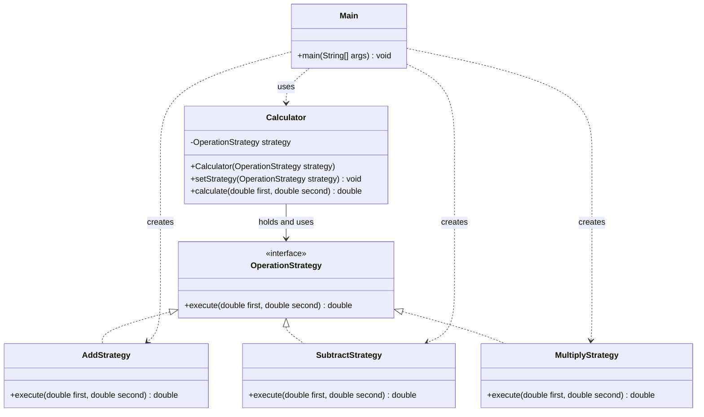

# Assignment 5 Strategy Pattern

Koishybay Zhasulan  
Group SE-2537

## 1. Introduction

I chose Option B, a calculator. The algorithm family contains addition, subtraction, and multiplication. All three operations take two numbers and return one result.

Without Strategy, a calculator could use an if/else chain to select an operation. In this project, each operation has its own class. Calculator uses the OperationStrategy interface and delegates the calculation to the selected object. Main selects the operation and can change it while the program is running.

## 2. UML class diagram



Calculator is the Context. OperationStrategy is the Strategy interface. The three operation classes are Concrete Strategies. Main is the Client. The dashed realization arrows mean that the operation classes implement the interface. Calculator holds a strategy reference, and Main creates and selects the concrete strategies.

## 3. Clean Code principles

### 1. Replace conditional selection with polymorphism

A possible version before Strategy would select the operation inside the Context:

```java
if (operation.equals("add")) {
    return first + second;
} else if (operation.equals("subtract")) {
    return first - second;
} else if (operation.equals("multiply")) {
    return first * second;
}
throw new IllegalArgumentException("Unknown operation.");
```

The actual Calculator delegates through the interface:

```java
public double calculate(double first, double second) {
    return strategy.execute(first, second);
}
```

The selected object's implementation determines the algorithm. Calculator has no if/switch on operation or strategy type.

### 2. Meaningful names

```java
Calculator calculator = new Calculator(new AddStrategy());
calculator.setStrategy(new SubtractStrategy());
```

The names describe the objects and actions. AddStrategy means addition, and setStrategy makes the change explicit.

### 3. Single Responsibility

```java
// AddStrategy has one job: addition.
@Override
public double execute(double first, double second) {
    return first + second;
}
```

Each strategy implements one operation. Main handles the console demonstration. Strategies do not print messages or select other strategies.

### 4. Keep the Context independent of concrete algorithms

```java
private OperationStrategy strategy;

public Calculator(OperationStrategy strategy) {
    setStrategy(strategy);
}
```

Calculator depends on the common interface. It does not create AddStrategy or inspect concrete class types. Its work stays the same when the selected algorithm changes.

### 5. Open for extension without changing the Context

```java
// A possible new class; not required by the current three-operation demo.
public class DivideStrategy implements OperationStrategy {
    @Override
    public double execute(double first, double second) {
        if (second == 0) {
            throw new IllegalArgumentException("Cannot divide by zero.");
        }
        return first / second;
    }
}
```

A client can select this new object using `calculator.setStrategy(new DivideStrategy())`. Calculator, the interface, and existing strategies remain unchanged. Only a new class and the client configuration are needed. Checking division by zero validates input; it does not select a strategy.

The Context also rejects a null strategy with Objects.requireNonNull. This keeps it ready to calculate after construction or a strategy change.

## 4. Strategy vs. State

Strategy selects how to perform a task. State changes an object's behavior according to its current internal state, often with transitions between states. My calculator needs different algorithms for the same task, not lifecycle states. Main explicitly chooses addition, subtraction, or multiplication. The strategies do not move the calculator to another state. This is why Strategy fits this problem.

## 5. Conclusion

The same Calculator object can use different operations at runtime. Main first selects addition, then subtraction, then multiplication, and finally addition again. With inputs 12 and 4, the results are 16, 8, 48, and 16.

Strategy keeps the Context simple and makes adding operations easier. The tradeoff is more classes and files. For only three short formulas, an if/else solution would be smaller, but this project demonstrates how operations can be separated and extended.

The project requires JDK 17 or newer and no additional libraries. Build and run commands are in README.md.

## 6. GitHub repository

Repository URL: REPLACE_WITH_YOUR_ACTUAL_GITHUB_REPOSITORY_URL
